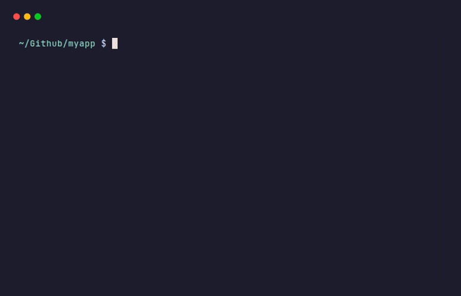

<div align="center">


# SeaShell

**Resume last night's Claude Code session from any terminal, by name.**

[](LICENSE)
[](https://www.swift.org)
[](https://github.com/M-Pineapple/seashell/stargazers)
[](https://glama.ai/mcp/servers/M-Pineapple/seashell)

An MCP server + shell toolkit that bridges [Wave Terminal](https://github.com/wavetermdev/waveterm), Claude Desktop, and Claude Code — turning multi-tab terminal work into seamless AI-collaborative coding.

[Quick start](#quick-start) · [Installation](#installation) · [Commands](#commands-youll-use-every-day) · [Limitations](#limitations) · [FAQ](#faq)



</div>

---

> **macOS only.** SeaShell is built for macOS (Swift, Darwin APIs) with Wave Terminal and Claude Desktop / Claude Code. It does not build or run on Linux or Windows.

## Quick start

```bash
# 1. Clone and build
git clone https://github.com/M-Pineapple/seashell ~/Github/seashell
cd ~/Github/seashell && ./build.sh

# 2. Connect Claude and install `hey`
#    Register the MCP server (Desktop config and/or `claude mcp add`. See Installation.)
cd examples/wave-config && ./install.sh
claude auth login

# 3. Resume a session
hey continue with <some-project>
```

Hooks, the optional daemon, and `hey what's the latest in <project>?` are in [Installation](#installation).

## What it is

SeaShell is a [Model Context Protocol](https://modelcontextprotocol.io) server (Swift) plus a small set of shell commands that together give you three things:

1. **Cross-terminal asynchronous messages.** Leave a note for Claude from any Wave Terminal block; pick up the answer in another. `seashell-msg`, `seashell-ask`.
2. **Resume any Claude Code session by name.** Walk away from a deep coding session in Claude Desktop's Code mode last night, open Wave this morning, type `hey continue with <project>` — same conversation, same memory. `hey`, `seashell-sessions`.
3. **Optional autonomous responses via a daemon.** Without you ever touching a chat, a small daemon spawns `claude -p` in the right project directory and answers your inbox. Uses your Claude subscription — no API key.

All three compose. You can mix-and-match.

## ✨ Marquee feature: `hey continue with <project>`

```
$ hey continue with myapp

🔄 Resuming session a1b2c3d4 (project: myapp)...

> What's the latest update on the auth refactor?

We finished extracting the AuthService. Tests pass. Next is wiring it
into the API layer — I have a draft in routes/auth.py on line 142.
Want me to walk through it?
```

That's a fresh terminal. **Same conversation history** as last night's Claude Desktop Code-mode session. Full project memory. Fuzzy matching — `hey continue with ma` works too.

Each project has a **pinned primary session** at `<project>/.seashell-inbox/primary-session.txt`, so `hey continue with <project>` always lands you in the same conversation — even if you've spawned multiple parallel sessions for the same repo. The pin is set automatically the first time you `seashell-init` (largest existing session wins) or on the first `claude` startup in that directory. Re-pin any session anytime with `seashell-sessions promote <id>`.

## Installation

### 1. Install Wave Terminal

[Download Wave Terminal](https://www.waveterm.dev/) and launch it once.

### 2. Install Claude Desktop and/or Claude Code CLI

You'll want at least one of:

- **Claude Desktop** — the GUI app from [claude.ai/download](https://claude.ai/download). Use this for general chat. The "Code" mode here persists sessions to disk and IS resumable from SeaShell.
- **Claude Code CLI** — install via npm: `npm install -g @anthropic-ai/claude-code`. This is what `hey continue with` actually invokes (via `claude --resume <id>`).

Most users want both.

### 3. Build SeaShell

```bash
git clone https://github.com/M-Pineapple/seashell ~/Github/seashell
cd ~/Github/seashell
./build.sh
```

`build.sh` produces `.build/release/seashell` (~16 MB).

### 4. Register the MCP server with Claude

You need to register SeaShell with **whichever Claude clients you use**. They're separate registrations.

#### a) Claude Desktop

Edit `~/Library/Application Support/Claude/claude_desktop_config.json`:

```json
{
  "mcpServers": {
    "seashell": {
      "command": "/absolute/path/to/seashell/.build/release/seashell",
      "args": ["--port", "9876"]
    }
  }
}
```

Restart Claude Desktop. The 60+ SeaShell tools appear in the available-tools list.

#### b) Claude Code CLI

```bash
claude mcp add --scope user seashell \
    /absolute/path/to/seashell/.build/release/seashell -- --port 9879
```

The different port (`9879`) avoids a clash if you run both Desktop and CLI invocations in parallel. `--scope user` means the registration is global — visible from any directory.

### 5. Sign in to your Claude subscription

```bash
claude auth login
```

This opens a browser for OAuth into your Claude.ai account. **No API key needed** — `claude -p` (and the optional daemon) draws from your Pro/Max subscription via this auth.

### 6. (Optional but recommended) Install the example bundle

```bash
cd ~/Github/seashell/examples/wave-config
./install.sh
```

This snapshots your existing fish + Wave configs to `~/.seashell-backups/<timestamp>/`, then installs:

- `~/.local/bin/seashell-msg`, `seashell-ask`, `seashell-init`
- `~/.local/bin/hey`, `seashell-sessions`, `seashell-setup-hooks`
- `~/.local/bin/seashell-session-start`, `seashell-post-tool-use` (Claude Code hooks)
- `~/.config/fish/` (a working fish config with NL routing, atuin, fastfetch, theme-sync)
- `~/.config/fastfetch/config.jsonc`
- `~/Library/LaunchAgents/dev.seashell.theme-sync.plist` (auto light/dark for Wave)

### 7. (Optional) Wire the Claude Code hooks

```bash
seashell-setup-hooks
```

Adds two entries to `~/.claude/settings.json`:

- **SessionStart hook** — registers each interactive `claude` REPL in `~/.seashell/sessions/<id>.json` with project label and Wave block ID
- **PostToolUse hook** — appends every tool call to `~/.seashell/sessions/<id>/activity.log` and updates a "current file" pointer when Claude does Edit/Write

The hooks **only fire for interactive TTY sessions** (a real `claude` REPL inside a Wave block). They do NOT fire for `claude -p` invocations. SeaShell's `seashell-sessions` command works regardless because it falls back to scanning `~/.claude/projects/`.

### 8. (Optional) Install the autonomous daemon

```bash
cd ~/Github/seashell/examples/seashell-daemon
./install.sh
```

The daemon polls every project's inbox every 5 seconds. When something lands, it spawns `claude -p` from that project's directory to read and respond. Uses your Claude subscription via the CLI auth from step 5.

See [`examples/seashell-daemon/README.md`](examples/seashell-daemon/README.md) for details.

## Commands you'll use every day

### `hey` — natural-language entry point

```bash
hey continue with myapp                        # resume project's latest session
hey resume ma                                  # fuzzy match (initials work)
hey let's work on the seashell project        # natural language continuation
hey what's the next thing on the refactor?    # routes to inbox (waits for reply)
swift build 2>&1 | hey "fix these errors"     # pipe + ask
```

If the first words look like a session-resume intent (`continue`, `resume`, `let's work on`, `go back to`, `pick up`), `hey` runs `claude --resume <id>`. Otherwise it falls through to `seashell-ask`.

### `seashell-sessions` — see your Claude Code sessions

```bash
seashell-sessions                  # list everything
seashell-sessions latest <name>    # print the most recent session id matching <name>
seashell-sessions primary <name>   # print the project's pinned primary session id
                                   #   (falls back to latest if none pinned)
seashell-sessions promote          # pin most-recent session as primary for $PWD
seashell-sessions promote <id>     # pin a specific session (project inferred from its cwd)
seashell-sessions show <id>        # full metadata for one session
seashell-sessions resolve <name>   # fuzzy-match and print the best id
```

Reads from THREE sources:
- `~/.seashell/sessions/` — hook-registered sessions (★ marker in `list`)
- `~/.claude/projects/<encoded-cwd>/<id>.jsonl` — filesystem-discovered (every session, every project)
- `~/Library/Application Support/Claude/claude-code-sessions/<account>/<bridge>/local_*.json` — Claude Desktop's session wrappers, which contribute Desktop's user-friendly **titles** and **archived flag**

This three-source read means fuzzy matching works against Desktop titles too: `hey continue with the current trader pro` will find a session titled `Current Trader Pro Development Session` in Desktop, even if its on-disk cwd basename (e.g. `Github`) wouldn't match. Archived sessions get an `A` marker in `list` and are excluded from fuzzy matching by default — so a long-archived experiment can't be resurrected by accident.

The pinned primary session lives at `<project>/.seashell-inbox/primary-session.txt` and is what `hey continue with <project>` resumes.

### `seashell-msg` — leave Claude a note

```bash
seashell-msg "compare the test output to what we discussed"
swift build 2>&1 | seashell-msg "fix these errors"
seashell-msg --file /tmp/build.log "investigate this"
seashell-msg --global "skip cwd routing"
```

Auto-routes to the nearest `.seashell-inbox/` ancestor; falls back to `~/.seashell/inbox.jsonl`.

### `seashell-ask` — blocking question

```bash
seashell-ask "what's the status of the refactoring?"      # blocks up to 600s
seashell-ask --timeout 60 "did the build pass?"           # custom timeout
seashell-ask --no-wait "post and exit"                    # fire-and-forget with reply token
```

Posts a message with a `reply_token`, polls for a matching reply in `replies.jsonl`, prints when found.

### `seashell-mirror-mcp` — keep CLI and Desktop MCP servers in sync

```bash
seashell-mirror-mcp --dry-run     # preview what would be added (env values redacted)
seashell-mirror-mcp --list        # just print the diff
seashell-mirror-mcp               # apply: clone Desktop MCP entries to the CLI (additive)
seashell-mirror-mcp --update      # force re-sync EVERY Desktop server (picks up rotated tokens,
                                  # env-var changes, command edits). Removes + re-adds each entry.
                                  # Doesn't touch CLI-only servers (e.g. seashell).
```

Claude Desktop and Claude Code CLI use **separate config files** for MCP server registration (`claude_desktop_config.json` vs `~/.claude.json`), even though they share the same session `.jsonl` storage. So a session resumed via `hey continue with <project>` may be missing tools that Desktop has — e.g. you can ask Claude about Trello in Desktop but the resumed CLI session has no Trello MCP. This script mirrors Desktop → CLI (additive only, never removes), making the tool surface match. Idempotent and safe to re-run whenever you add a new server in Desktop.

Dry-run output redacts env values for keys that look like secrets (anything matching the components `KEY`, `TOKEN`, `SECRET`, `PASSWORD`, `API`, `AUTH`, `CREDENTIAL`, `PAT`). The actual `claude mcp add` calls use the real values from your Desktop config.

### `seashell-init` — register a project

```bash
cd ~/Github/your-project
seashell-init
```

Creates `.seashell-inbox/`, registers the project in `~/.seashell/projects.jsonl`, writes (or extends) `CLAUDE.md` with an inbox hint.

## MCP tools surface (60+ tools)

Grouped by tier. Used by Claude (in Desktop, in `claude` REPLs, in the daemon) — **not** typed by you.

### Inbox (Tier A — safe)
- `read_user_inbox`, `inbox_count`, `inbox_history`, `reply_to_user`, `read_my_replies`

### Cross-session peeking (Tier A — safe)
- `read_session_transcript` — read the most recent N turns of any project's primary session (or any session by id) without resuming it. Lets Claude Desktop answer "what's the status of project X?" by quoting the actual transcript instead of guessing.

### Direct Wave config (Tier A read / Tier B write)
- `wave_get_settings`, `wave_set_setting`, `wave_get_widgets`, `wave_create_widget`, `wave_update_widget`, `wave_delete_widget`, `wave_get_ai_presets`, `wave_set_ai_preset`, `wave_set_theme`, `wave_set_appearance`, `wave_get_backgrounds`

### Wave helper-block tools (Tier A read / Tier B write)
- `wave_list_workspaces`, `wave_list_blocks`, `wave_get_scrollback`, `wave_get_block_meta`, `wave_set_block_meta`, `wave_create_block`, `wave_delete_block`, `wave_run_in_block`, `wave_view_file`, `wave_edit_file`

### Wave secrets (Tier C — explicit approval required)
- `wave_secret_list`, `wave_secret_set`, `wave_secret_get`, `wave_secret_delete`
- Every secrets tool needs `approved=true` and a non-empty `reason`. `wave_secret_get` withholds the plaintext value unless `SEASHELL_ALLOW_SECRET_READ=1` is set in the server environment.

### Command execution
- `execute_command`, `execute_with_auto_retrieve`, `execute_with_streaming`, `execute_pipeline`, `get_command_output`, `list_recent_commands`

### Templates, profiles, environment
- `save_template`, `run_template`, `list_templates`, `save_workspace_profile`, `load_workspace_profile`, `list_workspace_profiles`, `get_environment_context`, `capture_environment`, `diff_environment`

See [`docs/ARCHITECTURE.md`](docs/ARCHITECTURE.md) for the full tier table.

## Limitations

These aren't bugs — they're architectural realities worth knowing up front.

| Limitation | Why |
|---|---|
| **You can't target a specific Claude Desktop chat** with `seashell-msg` / `seashell-ask`. The MCP server is shared across all Desktop chats — there's no chat ID exposed to MCP. | Claude Desktop's MCP integration runs one shared MCP server per config entry, with no per-chat identifier. The workaround: use the daemon (project-scoped Claude per inbox) or use `hey continue with <project>` to resume a Claude Code session instead. |
| **Continuity works only for Claude Code sessions.** Claude Desktop's "Chat" mode and "Co-work" mode aren't resumable. Claude Desktop's "Code" mode IS — it persists to the same `~/.claude/projects/` storage as the CLI. | Chat and Co-work transcripts are internal to Desktop. Code mode shares the open `.jsonl` format with the CLI. Use Code mode if you want cross-day, cross-client continuity. |
| **Hooks (SessionStart, PostToolUse) fire only for interactive TTY sessions.** They do NOT fire for `claude -p` invocations. | This is a Claude Code behavior we accept. SeaShell's `seashell-sessions` falls back to scanning `~/.claude/projects/` so resume-by-name works regardless. The activity log + side blocks only populate during interactive sessions. |
| **Side blocks (activity tail + live code preview) only spawn from inside Wave Terminal.** They use `wsh createblock` which requires `WAVETERM_JWT`. | The hook checks for the env var before invoking `wsh`. When you start `claude` outside Wave (e.g. plain Terminal.app), the side blocks are silently skipped; everything else still works. |
| **The autonomous daemon's `claude -p` sessions don't update Claude Desktop's open chat in real time.** | Claude Desktop holds its own in-memory state. New turns appended to the `.jsonl` from `claude --resume -p` only become visible after Desktop refreshes/reopens the session. If you have a session open AND the daemon writes to it concurrently, last-write-wins on the file. Pick one or the other to be "live". |
| **High-volume use can hit Claude.ai subscription rate limits.** | The daemon batches one `claude -p` per project per polling cycle (default 5 s). For typical use this stays under limits. For heavy workloads, increase `SEASHELL_DAEMON_POLL`. |
| **The blocked-commands list is a guard against mistakes, not a security boundary.** | It matches command text, so a determined caller can rephrase or encode a command. Only connect SeaShell to clients you trust. |
| **No cross-machine sync** of inbox or session registry. | All state lives under `~/.seashell/` and `~/.claude/projects/`. You could symlink these into iCloud Drive but it's untested. |

## FAQ

### Why didn't my SessionStart hook fire?

Hooks fire only for **interactive TTY** sessions. If you started Claude with `claude -p "..."` (non-interactive) or piped stdin into `claude`, the hook is skipped. Run `claude` normally inside a Wave Terminal block to trigger it.

### What's the difference between Claude Desktop "Code" mode and Claude Code CLI?

They use the **same conversation file format** (`~/.claude/projects/<encoded-cwd>/<uuid>.jsonl`). Either can read/write a session. So you can:

- Start in Desktop Code mode, resume in Wave with `hey continue with <project>` ✅
- Start in `claude` REPL inside Wave, view in Desktop's Code mode sidebar later ✅
- Bounce back and forth across clients on the same conversation ✅

You **cannot** resume Desktop "Chat" or "Co-work" mode sessions — those are stored elsewhere and aren't exposed.

### Why two MCP server registrations (one for Desktop, one for CLI)?

Claude Desktop and Claude Code CLI maintain **separate** MCP configurations. Desktop reads `~/Library/Application Support/Claude/claude_desktop_config.json`; CLI reads `~/.claude.json`. We register on different ports (9876 vs 9879) so they don't collide if both spawn SeaShell at once.

### What's the difference between `seashell-msg` and `hey`?

- `seashell-msg "..."` always posts to the inbox (fire-and-forget).
- `seashell-ask "..."` posts and blocks waiting for a reply.
- `hey ...` is smarter: if the prompt looks like a session-resume request, it `claude --resume`s; otherwise it acts like `seashell-ask`.

Think of `hey` as the user-friendly umbrella; `seashell-msg`/`seashell-ask` are the lower-level primitives.

### Does the daemon cost money?

The daemon spawns `claude -p` which uses your **Claude.ai subscription** (Pro or Max), not the API. No per-token billing. You hit your subscription rate limits, not your wallet. If you don't have a subscription, the daemon won't work — install Claude Code from claude.ai.

### Can I use this without Wave Terminal?

Mostly yes. The MCP tools work in any client. The shell commands (`hey`, `seashell-msg`, etc.) work in any terminal. The **side blocks** (activity tail + live code preview) require Wave's `wsh createblock` — they silently no-op if run outside Wave.

### What happens if I start two `claude` REPLs in the same project directory?

Each gets its own UUID, its own `.jsonl` file, its own conversation. They're independent. `hey continue with <project>` resumes the **most recently active** one.

### How do I make my Wave Terminal command run autonomously without me checking back?

Install the daemon (step 8). Then any `seashell-ask` from any block will get answered by `claude -p` within ~5 seconds, no chat needed.

### How do I uninstall?

```bash
# Daemon
launchctl unload ~/Library/LaunchAgents/dev.seashell.daemon.plist
rm ~/Library/LaunchAgents/dev.seashell.daemon.plist
rm ~/.local/bin/seashell-daemon

# Theme sync
launchctl unload ~/Library/LaunchAgents/dev.seashell.theme-sync.plist
rm ~/Library/LaunchAgents/dev.seashell.theme-sync.plist

# Shell commands and hooks
rm ~/.local/bin/seashell-* ~/.local/bin/hey

# Hooks from Claude config (manual edit)
# Open ~/.claude/settings.json and remove the SeaShell entries from the "hooks" key

# State
rm -rf ~/.seashell

# MCP server registrations (manual)
# Remove "seashell" entry from ~/Library/Application Support/Claude/claude_desktop_config.json
# claude mcp remove seashell

# Restore old fish config
mv ~/.config/fish ~/.config/fish.removed
mv ~/.seashell-backups/<timestamp>/fish ~/.config/fish
```

### How can I see what the daemon is doing right now?

```bash
tail -f /tmp/seashell-daemon.log
```

You'll see every poll cycle, every spawned `claude -p`, and Claude's response timing.

### Can the daemon talk to itself? (i.e. infinite loop)

The daemon's `claude -p` is restricted to four tools: `inbox_count`, `inbox_history`, `read_user_inbox`, `reply_to_user`. It can't post new inbox messages — only consume and reply.

### What do I do if my hook fired wrong / something broke / I want to reset?

Delete `~/.seashell/sessions/<bad-id>/` and `~/.seashell/sessions/<bad-id>.json`. The next interactive `claude` will register fresh. Your `~/.claude/projects/` history is preserved.

### Why is my inbox showing messages I didn't send?

Most likely your `claude -p` (e.g. from the daemon) called `read_user_inbox` and it returned messages from a different cwd's inbox. SeaShell aggregates inboxes across all known projects + global by default. Use `inbox_count` to see the per-project breakdown.

### Where do I report bugs?

Open an issue at [github.com/M-Pineapple/seashell/issues](https://github.com/M-Pineapple/seashell/issues).

## Architecture & docs

- **[`docs/ARCHITECTURE.md`](docs/ARCHITECTURE.md)** — System overview, layers, MCP tool surface, Wave object model
- **[`docs/INBOX.md`](docs/INBOX.md)** — Storage layout, routing rules, daemon architecture, troubleshooting
- **[`docs/WAVE_INTEGRATION.md`](docs/WAVE_INTEGRATION.md)** — How SeaShell talks to Wave: `wsh`, `WAVETERM_JWT`, RPC mechanism
- **[`docs/HELPER_PROTOCOL.md`](docs/HELPER_PROTOCOL.md)** — Wire protocol between the external server and the in-Wave helper

## Project layout

```
seashell/
├── README.md                       ← you are here
├── LICENSE                         ← MIT
├── Package.swift                   ← Swift package manifest
├── build.sh / clean.sh             ← build scripts
├── setup.sh                        ← post-clone bootstrap
├── assets/logo.svg, demo.gif       ← logo + README demo (regenerate with docs/demo/record.sh)
│
├── Sources/
│   ├── Seashell/                   ← MCP server, tool handlers, Wave adapter
│   │   ├── InboxHandlers.swift     ← inbox tools (read/count/history/reply/read_my_replies)
│   │   └── …                       ← 30+ other handler files
│   └── ConfigManager/              ← standalone config-management binary
├── Tests/SeashellTests/
│
├── helper/seashell-helper          ← in-Wave Python helper (TCP proxy to wsh)
├── config/                         ← Claude Desktop config template
├── docs/                           ← architecture, INBOX, integration, helper protocol
│   ├── demo.tape                   ← VHS script for assets/demo.gif
│   └── demo/                       ← fixtures + record.sh
├── prompts/                        ← AI-assisted configuration prompts
│
└── examples/
    ├── wave-config/
    │   ├── bin/                    ← shell commands: hey, seashell-msg/ask/init/sessions/setup-hooks
    │   ├── hooks/                  ← Claude Code SessionStart + PostToolUse scripts
    │   ├── fish/                   ← starter fish stack
    │   ├── fastfetch/              ← system-info banner config
    │   ├── wave/                   ← Wave widgets/settings templates
    │   ├── theme-sync/             ← auto light/dark switcher
    │   └── install.sh              ← installs all the above into your $HOME
    └── seashell-daemon/            ← autonomous inbox responder via claude -p
```

## Acknowledgments

- **[Wave Terminal](https://github.com/wavetermdev/waveterm)** — the terminal SeaShell is built around. Open-source, block-based, deeply scriptable.
- **[Anthropic](https://www.anthropic.com/)** — for the [Model Context Protocol](https://modelcontextprotocol.io), Claude Desktop, and Claude Code CLI.
- **[fish shell](https://fishshell.com/)**, **[atuin](https://atuin.sh/)**, **[starship](https://starship.rs/)**, **[zoxide](https://github.com/ajeetdsouza/zoxide)**, **[fastfetch](https://github.com/fastfetch-cli/fastfetch)** — small tools that make the example config worth running.
- **[Ollama](https://ollama.com/)** + the **Qwen** team — for the local LLM that powers the optional natural-language fish layer.

## More MCP servers by M-Pineapple

Other MCP servers in this portfolio:

- [Claude Project Coordinator](https://github.com/M-Pineapple/Claude-Project-Coordinator). Track Xcode projects, status, tech stack and health.
- [CryptoAnalysisMCP](https://github.com/M-Pineapple/CryptoAnalysisMCP). Cryptocurrency technical analysis for Claude Desktop.
- [Warp Command Runner](https://github.com/M-Pineapple/warp-command-runner). Give any chat AI a real terminal.
- [Msty Admin MCP](https://github.com/M-Pineapple/msty-admin-mcp). Administer Msty Studio Desktop.
- [Member Berries](https://github.com/M-Pineapple/member-berries-apple-mcp). Apple Calendar, Notes and Reminders with personality.
- [TextEdit MCP](https://github.com/M-Pineapple/TextEdit-MCP). Formatted RTF documents via macOS TextEdit.
- [HubSpot Auditor](https://github.com/M-Pineapple/hubspot-auditor). Read-only HubSpot portal audit.

If this saves you time, a [star](https://github.com/M-Pineapple/seashell) helps others find it.

## 💖 Support This Project

If SeaShell has helped enhance your development workflow or saved you time, consider supporting its development:

<a href="https://www.buymeacoffee.com/mpineapple" target="_blank"></a>

Your support helps me:
* Maintain and improve SeaShell with new features
* Keep the project open-source and free for everyone
* Dedicate more time to addressing user requests and bug fixes
* Explore new integrations and features

Thank you for considering supporting my work! 🙏

## License

MIT — see [LICENSE](LICENSE).

Built with 🐚 by Pineapple 🍍
